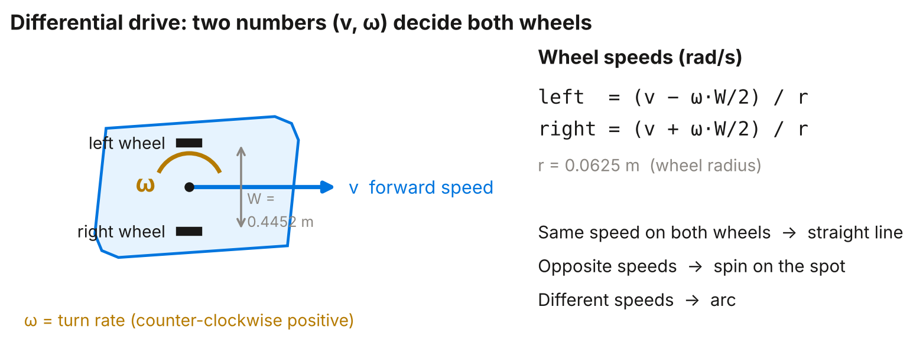
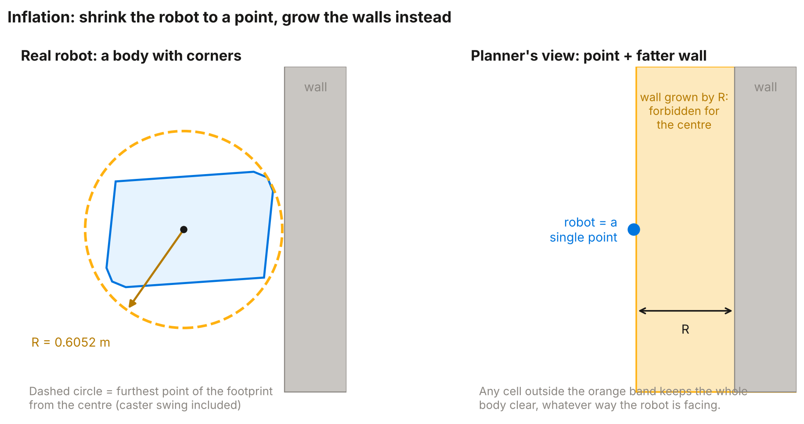
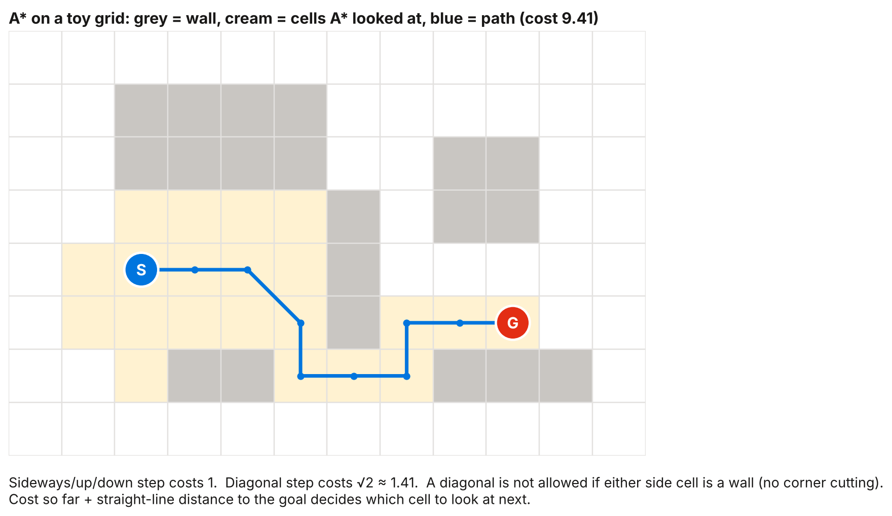
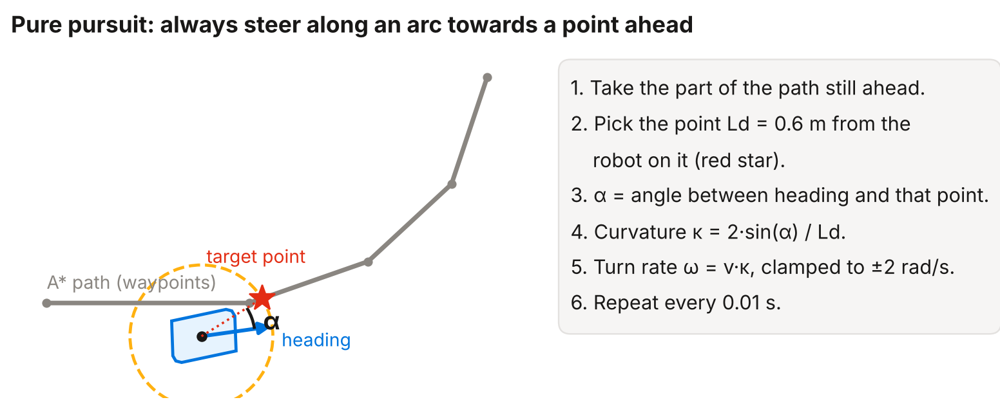
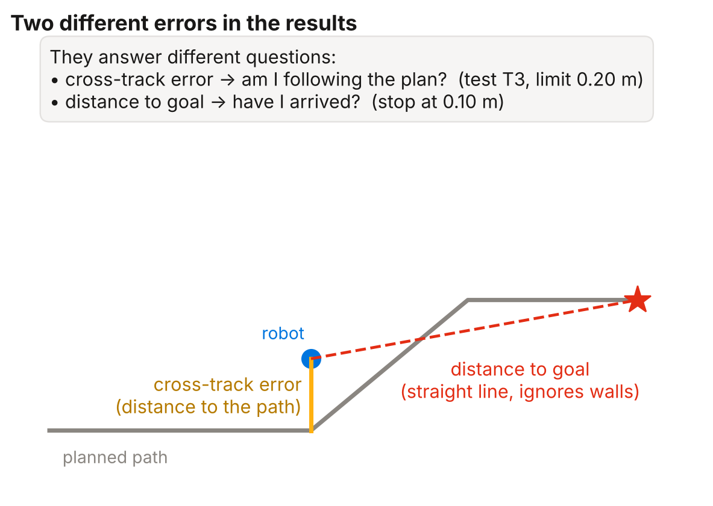
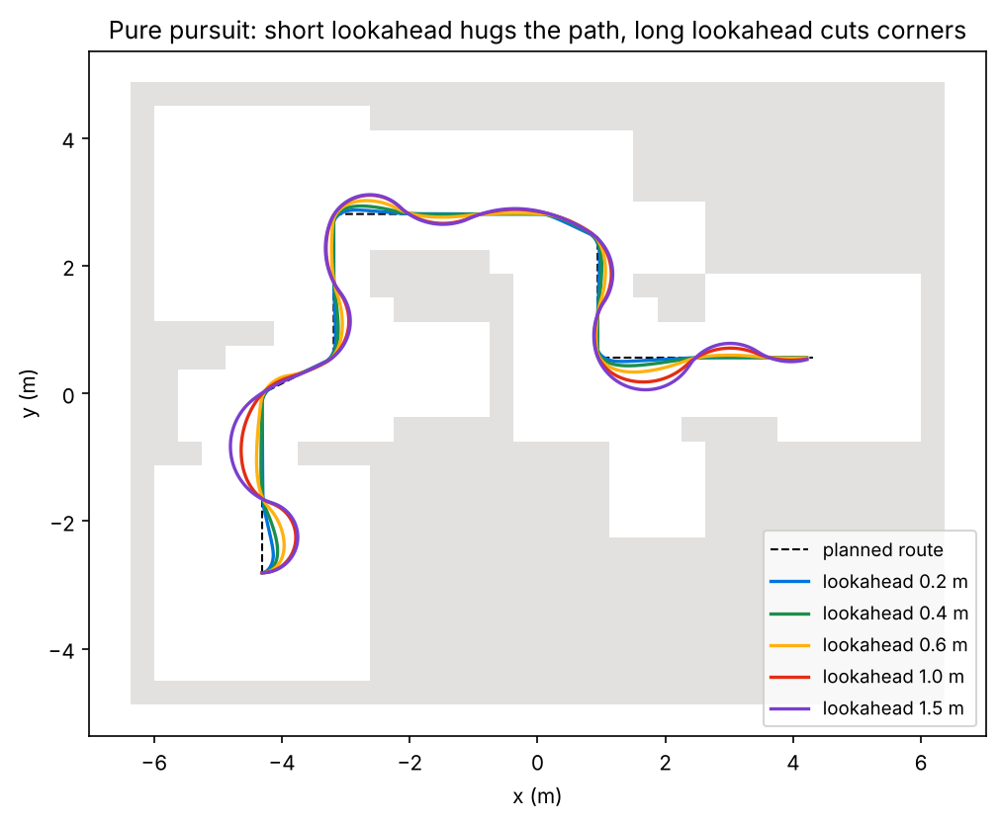

# Learn this project from zero

For: someone who knows no MATLAB, robotics or simulation, and has to defend this
project to a PhD professor. Plain words first, then the maths, then the exact
code, then how to say it.

**Rule for the whole guide:** every number comes from the project's own logs
(`matlab/validation/validation_results.txt`, `DEBUG_REPORT.md`) or from a
calculation shown here. Where something has *not* been run yet, it says so.

---

## 0. How to use this guide

| Day | Read | Do (30–60 min) |
|---|---|---|
| 1 | §1, §2 | Run `results = run_all;` in MATLAB. Watch it. Read the printed lines. |
| 2 | §3, §4.1 | Redo the wheel-speed example by hand. |
| 3 | §4.2, §4.3 | Open `plan_path.m` lines 60–75. Say aloud what each line does. |
| 4 | §4.4 | Run the A* by hand on the toy grid (Fig 4). |
| 5 | §4.5, §5 | Run `python docs/learning/lookahead_experiment.py`. Explain the picture. |
| 6 | §4.6–§4.9 | Open `navigation_graphs.png` from your run. Explain every panel. |
| 7 | §6, §7 | Mock viva: cover the answers, answer the questions aloud. |

Two habits that make you hard to fool: **(1)** always say the *unit*
(metres, seconds, radians); **(2)** always say *what was measured* and *what
was only assumed*.

---

## 1. The whole project in 60 seconds

- **What it is:** a computer simulation of a real warehouse robot, the **MiR100**
  (an *AMR*: autonomous mobile robot), driving itself through a maze of 65 walls.
- **The task:** from a start point, get to a goal point **without touching any wall**.
- **How, in six steps:**
  1. Turn the walls into a **grid map** (5 cm squares, "free" or "wall").
  2. **Grow** every wall by the robot's radius, so the robot can be treated as a **point**.
  3. **A\*** finds the shortest grid path for that point from start to goal.
  4. **Pure pursuit** steers the robot along that path.
  5. **Differential-drive kinematics** turns steering into wheel speeds and moves the robot a tiny step, 100 times per second.
  6. A **clearance check** measures the gap between the real robot outline and every wall at every moment.
- **What it proves:** the planning, steering and safety-checking logic works.
- **What it does *not* prove:** how a real MiR100 behaves (no mass, friction, slip, sensors or delays are simulated).

The chain, with the file that does each step:

| Step | Does | File (in `matlab/`) |
|---|---|---|
| 1 | read the 65 walls | `world/read_world_boxes.m` |
| 2 | build 3D world + robot | `world/build_world.m`, `robot/load_mir100.m`, `robot/spawn_mir100.m` |
| 3 | occupancy grid | `map/build_map.m` |
| 4 | plan the path | `planning/plan_path.m` |
| 5 | drive along it | `control/follow_route.m` |
| 6 | check safety | `collision/check_run_clearance.m` |
| 7 | graphs + numbers | `demo/navigation_diagnostics.m` |
| 8 | replay in 2D/3D | `demo/make_demo.m` |
| 9 | independent tests | `validation/run_validation.m` |

`run_all.m` calls them in this order.

---

## 2. Words you must know

| Word | Plain meaning |
|---|---|
| **AMR** | Autonomous Mobile Robot: drives itself, no wire or track. |
| **MiR100** | A real warehouse robot from Mobile Industrial Robots. We simulate its *model*. |
| **URDF** | A text file describing a robot's parts, joints and 3D shapes. |
| **Mesh / STL** | A 3D shape file. The robot's body in the 3D view is made of meshes. |
| **Simulation** | Running a computer model instead of the real thing. |
| **Kinematics** | Motion described by geometry only: positions and speeds. No forces. |
| **Dynamics** | Motion including mass, force, friction, acceleration. **Not** simulated here. |
| **Pose** | Where the robot is and which way it faces: (x, y, yaw). |
| **Yaw** | Heading angle, counter-clockwise from the +x axis, in **radians**. |
| **Differential drive** | Two driven wheels, one each side. Speed difference makes it turn. |
| **Waypoint** | One point on a path. The robot must reach them in order. |
| **Occupancy grid** | A map cut into squares, each "free" or "occupied". |
| **Resolution** | Square size. Here 0.05 m (5 cm), i.e. 20 cells per metre. |
| **Inflation** | Making walls fatter by the robot's radius. |
| **Footprint** | The robot's outline seen from above (an 8-corner polygon here). |
| **A\*** (A-star) | Search that finds the cheapest path on a grid, guided by a heuristic. |
| **Heuristic** | A cheap guess of remaining cost. Here: straight-line distance to goal. |
| **8-connected** | Moves allowed: up, down, left, right and the 4 diagonals. |
| **Pure pursuit** | Steering rule: aim at a point a fixed distance ahead on the path. |
| **Lookahead (Ld)** | That fixed distance. Here 0.6 m. |
| **Cross-track error** | Sideways distance from the robot to the planned path. |
| **Clearance** | Gap between robot outline and the nearest wall. 0 means touching. |
| **Tolerance** | Allowed error. Here: stop within 0.10 m of the goal. |
| **RMS** | "Root mean square": a typical size of the error (squares, averages, square-roots). |
| **Fail-closed** | If unsure or impossible, do nothing. Blocked goal → robot does not move. |
| **Deterministic** | Same input always gives the same output. |
| **Validation** | Checking the result against a stated requirement (tests T1–T6). |
| **Lidar** | Laser distance sensor. **Not** used in the main run. |

---

## 3. Foundations: five ideas behind every formula

**3.1 Units.** Distance in **metres**, time in **seconds**, angles in
**radians** (π rad = 180°). Speeds: m/s and rad/s. Mixing degrees and radians
is the most common bug in robotics.

**3.2 Frames.** Positions only mean something relative to an origin. This
project uses the **world frame**. The older map frame is shifted:
`world = map + [−4.31, −2.81]`. The robot starts at world (−4.31, −2.81);
the standard goal is (4.31, 0.56). x points right (east), y up (north).

**3.3 Heading and rotation.** To rotate a point by angle θ:

    x' = x·cosθ − y·sinθ
    y' = x·sinθ + y·cosθ

Rotating the robot's outline by its yaw and adding its (x, y) puts the outline
in the world. The clearance check does exactly this at every moment.

**3.4 Wrapping angles.** Angles repeat every 2π, so 190° and −170° are the same
direction. `wrap_to_pi` squeezes an angle into (−π, π]. The steering error α
is wrapped. But the logged yaw is kept **continuous** (never wrapped), or a
tiny turn across ±π would look like a huge spin to the clearance check.

**3.5 Simulation by small steps (Euler integration).** A computer cannot move
continuously. It takes tiny steps of `dt = 0.01 s`:

    yaw ← yaw + ω·dt
    x   ← x + v·cos(yaw)·dt
    y   ← y + v·sin(yaw)·dt

At 1 m/s that is 1 cm per step. This is the simplest method and accurate
enough here because the steps are small.

---

## 4. Stage by stage

Each stage: **Intuition → Maths → Code → Numbers → Say it like this.**

### 4.1 Robot model and differential drive

**Intuition.** Two driven wheels. Both same speed → straight. Opposite → spin
on the spot. Different → arc. The robot is told *one* forward speed `v` and *one*
turn rate `ω`; we need each wheel's speed.

**Maths.** Each wheel's rim speed is `v ∓ ω·W/2` (the outer wheel travels a
bigger circle). Divide by the wheel radius `r` to get rotation speed:

    left  = (v − ω·W/2) / r        right = (v + ω·W/2) / r

with `W = 0.4452 m`, `r = 0.0625 m`. **Worked example:** v = 0.9 m/s, ω = 0.5 rad/s:

    left  = (0.9 − 0.5·0.2226) / 0.0625 = 12.62 rad/s
    right = (0.9 + 0.5·0.2226) / 0.0625 = 16.18 rad/s

Right wheel faster → the robot turns left (counter-clockwise). ✔

**Code.** `control/follow_route.m` lines 178–180. The model itself is the
official MiR100 URDF imported by `robot/load_mir100.m`: 20 links, 19 joints,
10 movable, mass 69.24 kg.

**Say it:** *"We use the real MiR100 description. The controller outputs a
forward speed and a turn rate; the differential-drive equations convert them
into left and right wheel speeds, which are integrated into wheel angles to
animate the wheels."*

> Honest detail: the robot's **position** is integrated from (v, ω), not from
> the wheel angles. The wheel angles are computed from the same (v, ω) for the
> animation, so they are consistent by construction, not an independent check.

### 4.2 World and occupancy grid

**Intuition.** Cut the floor plan into 5 cm squares. A square is "wall" if any
wall overlaps it. The planner searches this grid.

**Numbers.** 65 walls, all 2.2 m tall (a flat 2D map ignores height). Grid
about 216 × 276 cells (≈ 59,600 cells). Walls come from the Gazebo world file
`hard_world.sdf` of the companion ROS 2 project.

**Code.** `map/build_map.m` lines 46–55: for every cell centre, test whether it
lies within a wall box grown by half a cell. Overlap ⇒ occupied (deliberately
**conservative**: when unsure, call it a wall).

**Say it:** *"The grid is conservative: a cell touching a wall counts as wall,
so errors can only make the robot more cautious, never less."*

### 4.3 Inflation: the key trick

**Intuition.** Planning for a big robot with corners is hard. Planning for a
**point** is easy. So shrink the robot to a point and **grow every wall** by
the robot's radius. If the point stays outside the grown walls, the real robot
stays clear.

**Maths.** Growing a shape by a disc is a *Minkowski sum* (the classic
"configuration space" idea). The radius used is the **furthest footprint point
from the centre**, 0.6052 m (caster swing included).

The code adds a small safety pad for the grid being square: `√2 + 0.05` cells
= 1.464 × 5 cm ≈ **7.3 cm**. So the robot's centre must stay at least
**0.6052 + 0.0732 ≈ 0.678 m** from every wall.

**Code.** `planning/plan_path.m` lines 67–73: `rEff = inflateM + (√2+0.05)/res`,
build a disc, `conv2` smears every wall cell by it.

**Numbers.** Footprint: 1.022 m long, 0.709 m wide. A **circle** of radius
0.6052 is much fatter than a 0.709 m-wide robot, so it is *over-cautious*: it
rejects a 1.125 m corridor (< 2 × 0.6052 = 1.21 m) that the real robot could
pass sideways. The code comment says this openly.

**Say it:** *"We trade completeness for safety: a circular footprint is
conservative and may reject narrow passages, but it can never approve an unsafe
one. The planner never shrinks the radius to force a path."*

### 4.4 A\* path planning

**Intuition.** Explore outward from the start, always expanding the cell with
the lowest **(cost so far) + (straight-line distance still to go)**. The second
term pulls the search towards the goal so it wastes less effort.

**Maths.** Moves cost 1 (straight) or √2 ≈ 1.414 (diagonal). Heuristic
`h` = straight-line distance to the goal. It never over-estimates the true
remaining cost (it is *admissible*), so **A\* returns the cheapest path on the
grid**. The toy example above is computed for real: cost 9.41. Our code also
forbids cutting a corner: a diagonal move is not allowed if **either** of its two
side cells is a wall ("no corner cutting").

**Code.** `planning/plan_path.m` line 86 onward (heuristic line 89, corner-cut
rule line 103). Output: a list of points 5 cm apart (277 waypoints for the
standard goal). If no path exists, it returns the **reason** and the robot does
not move.

**Say it:** *"A\* is deterministic and optimal on the grid, and it tells us
clearly when no safe path exists. Sampling planners such as RRT add randomness
and need smoothing, with no benefit on a small fully-known 2D grid."*

> Know the limits: the path is optimal **on the grid** only. Grid paths turn in
> multiples of 45°, so a smooth any-angle path would be shorter. We chose not to
> smooth it (smoothing could clip an inflated corner).

### 4.5 Pure pursuit: following the path

**Intuition.** Drive as if you hold a carrot on a stick 0.6 m ahead along the
path: always steer towards the carrot.

**Maths.** Let α be the angle between the robot's heading and the target
point at distance `Ld`. Find the circle that is tangent to the heading at the
robot and passes through the target. In the robot's frame the target is
`(Ld·cosα, Ld·sinα)`; the circle's centre is `(0, ρ)`:

    (Ld·cosα)² + (Ld·sinα − ρ)² = ρ²   ⟹   Ld² = 2·ρ·Ld·sinα
    ρ = Ld / (2·sinα)   ⟹   curvature κ = 1/ρ = 2·sinα / Ld

Then `ω = v·κ`. The forward speed shrinks when the turn is sharp:
`v = 1.0 · max(0.15, 1 − |α|/(π/2))`. If the target is behind (|α| > 90°), the
robot spins on the spot.

**Worked example:** α = 30°, Ld = 0.6 m: κ = 2·0.5/0.6 = 1.67 per metre;
v = 1.0·(1 − 0.333) = 0.667 m/s; ω = 0.667 × 1.67 = 1.11 rad/s.

**Code.** `control/follow_route.m` lines 157–168 (steering), 158 (spin rule),
164 (speed rule). Settings: lookahead 0.6 m, max 1.0 m/s, max 2.0 rad/s,
waypoint radius 0.15 m, goal radius 0.10 m.

**Say it:** *"Pure pursuit is a geometric path tracker. It cuts corners
slightly because it aims ahead of itself; that is measured as tracking error."*

### 4.6 The simulation loop

Every 0.01 s: (1) mark waypoints reached (within 0.15 m, in order, none
skipped) → (2) pick the target point → (3) compute `v, ω` → (4) move the pose
one step (§3.5) → (5) integrate wheel angles → (6) log (t, x, y, yaw).
Stop when the final waypoint is reached within 0.10 m, or at 600 s
(`follow_route.m` lines 122–173).

### 4.7 The clearance check (the safety evidence)

**Intuition.** After driving, rebuild the whole motion and, at every moment,
measure the shortest distance between the **real robot outline** (not a point,
not a circle) and **every wall**.

**How.** (1) Subdivide motion so no step exceeds 4 cm or 3° (`check_run_clearance.m`
line 59). (2) At each pose, rotate the footprint into place (§3.3).
(3) Compute polygon-to-polygon distance, using `polygon_clearance.m`.
(4) Take the minimum.

**Between samples.** A finite log could hide a brief touch *between* two
samples. A bound closes the gap. Any robot point lies within `R = 0.6052 m` of
the centre. Between two samples, the nearer sample is at most half a step away,
so any point has moved by at most

    residual = Δxy/2 + 2·R·sin(Δyaw/4)

(centre shift + chord swept by the rotation). Distance changes by at most as
much as the point moves, so

    clearance anywhere in the step  ≥  min(clearance at both ends) − residual

(`check_run_clearance.m` lines 102–103). Measured: minimum clearance
**0.2213 m**, certified lower bound **0.2111 m** (about 1 cm lower).

**Say it:** *"Clearance is measured on the true footprint at every pose, with a
mathematical bound for the motion between samples. The bound assumes straight
motion and linear yaw between logged poses, which is true for our 1 cm steps."*

### 4.8 The validation tests (T1–T6)

Written before running, thresholds fixed in advance (`validation/TESTS.txt`),
and **independent** of the main run (they rebuild everything themselves).

| Test | Question | Result in your run |
|---|---|---|
| T1 | all waypoints reached, goal reached, zero collisions | 277/277, 0.100 m, 0 |
| T2 | clearance above zero | 0.2213 m |
| T3 | tracking error ≤ 0.20 m | max 0.114, RMS 0.022 |
| T4 | wheel radius, wheel gap, mass, frames match the model | 11/11 sub-checks |
| T5 | straight 2 m and half-turn accurate | 0.0000 m, 0.0084 rad |
| T6 | simulated vs wall-clock time | 16.38 s in 40.59 s (report only) |

### 4.9 Reading your results

- **Distance to goal** (straight line) answers "have I arrived?" The stop rule is 0.10 m.
- **Cross-track error** answers "am I following the plan?" Max 0.114 m, RMS 0.022 m.
- **Average speed** = 14.82 m / 16.38 s ≈ 0.905 m/s.
- **RMS** (0.022 m) is the typical error; **max** (0.114 m) is the worst moment, at a corner.

---

## 5. Experiment: change one number, see what happens

`docs/learning/lookahead_experiment.py` runs the Python mirror of the follower
(`matlab/ref/follow_route_ref_check.py`) with different lookahead distances.
No MATLAB needed: `python docs/learning/lookahead_experiment.py` (needs numpy,
matplotlib, shapely).

| Lookahead | Time | Max cross-track | RMS | Min clearance |
|---:|---:|---:|---:|---:|
| 0.2 m | 18.0 s | 0.175 m | 0.039 m | 0.104 m |
| 0.4 m | 19.5 s | 0.242 m | 0.065 m | 0.077 m |
| **0.6 m (default)** | 21.9 s | 0.345 m | 0.111 m | 0.017 m |
| 1.0 m | 27.2 s | 0.527 m | 0.201 m | 0.000 m (touches) |
| 1.5 m | 30.2 s | 0.558 m | 0.243 m | 0.000 m (touches) |

**Lesson:** a longer lookahead cuts corners harder, so tracking error grows and
clearance shrinks until the robot touches a wall. A shorter one hugs the path.

**Read this table honestly.** It is the **Python mirror** on the **older
16-waypoint route** (sharp corners, 1 m-class corridors), clearance sampled every
5th step. It is **not** MATLAB and **not** the A\* route (which measured 0.221 m,
a much easier path). The 0.6 m row matches the repo's own README (about 16 mm
minimum clearance). Use it to explain the *trend*, not to quote numbers in the
report. In this noise-free simulation shorter is always better; on a real robot
a very short lookahead can oscillate, which a kinematic simulation cannot show.

---

## 6. What a PhD professor will attack, and the honest answers

**W1. "It's only kinematic."** True. No mass, friction, slip, acceleration
limits or delays. *Answer:* the goal was to validate planning, steering and
safety logic; dynamics is stated future work. Speed and turn rate can change
instantly in the model, which a real robot cannot.

**W2. "Is it guaranteed safe?"** Not by the planner. The planner's pad is about
7 cm, but the worst tracking error is 11.4 cm, which is larger. So safety is
**verified after the fact** by the clearance check, not guaranteed by
construction. *Answer:* "We certify each run. A stronger design adds a larger
pad or puts clearance into the controller. Our run's minimum was 0.221 m."

**W3. "0.100 m goal error, is that your accuracy?"** No. The robot stops as soon
as it is inside the 0.10 m tolerance, so that figure is a *setting*, not an
accuracy result. The meaningful accuracy numbers are the tracking error and
clearance.

**W4. "What does T5 test?"** It checks MATLAB's own differential-drive object
with the project's wheel constants (a sanity check of the constants), not
`follow_route` itself. *Answer:* T5 is a unit check; T1–T3 test the integrated run.

**W5. "No localisation, no sensors."** Correct: the simulator's pose is exact
truth and the map is perfectly known. A real robot needs localisation (e.g. a
particle filter) and sensing. A reactive lidar module exists but is optional and
not in the main run.

**W6. "Your path is jagged / not shortest."** A\* is optimal on an 8-connected
grid, not in continuous space; headings are multiples of 45°. We deliberately do
not smooth it (a smoothed chord could clip an inflated corner).

**W7. "Why a circle for a rectangle?"** Heading-independent and safe, but
conservative: it rejects a 1.125 m corridor the real robot could pass. A
heading-aware planner would fix this (an SE(2) lattice exists in the optional
reaction module, with open review items).

**W8. "One goal is not an evaluation."** Fair. The validation battery uses one
standard goal. A stronger evidence set runs many goals and reports success rate,
time and minimum clearance. (Natural next step.)

**W9. "Were the parameters tuned?"** The lookahead 0.6 m and speed limits are
module defaults; §5 shows the sensitivity. Do not claim they were optimised.

**W10. "Is the 3D view evidence?"** No, it is visualisation. The walls are drawn
shorter in 3D so the robot is visible; all numbers come from the 2D geometry.

**W11. "What did you actually do?"** Answer truthfully and specifically (see §9).

---

## 7. Thirty questions with short answers

1. **What is an AMR?** A robot that navigates by itself, planning its own path.
2. **Why a point robot?** Inflating walls reduces a hard shape problem to an easy point problem.
3. **What is inflation radius and why 0.6052?** Furthest footprint point from the centre; plus a 7.3 cm grid pad.
4. **Why 5 cm cells?** Fine enough for 0.2 m clearances, coarse enough to search fast; finer cells cost more compute.
5. **Why A\* not Dijkstra?** Same path, fewer expansions thanks to the heuristic.
6. **Why A\* not RRT/PRM?** Known 2D grid: deterministic, optimal on grid, clean failure reporting.
7. **Is your heuristic admissible?** Yes: straight-line distance never exceeds true grid cost.
8. **What if the goal is inside a wall?** The planner reports why and the robot does not move.
9. **Why 8-connected?** Diagonals give shorter, less staircase-like paths than 4-connected.
10. **What is pure pursuit?** Steer along an arc to a point Ld ahead on the path.
11. **Derive curvature 2 sinα / Ld.** §4.5.
12. **Effect of larger lookahead?** Smoother but cuts corners; larger error, less clearance (§5).
13. **Why rotate in place when the target is behind?** A unicycle cannot reverse here; |α| > 90° means turning first.
14. **How do wheel speeds follow from v and ω?** §4.1.
15. **What is the time step and does it matter?** 0.01 s; at ≤ 1 m/s each step is ≤ 1 cm, so Euler error is negligible.
16. **Why Euler integration?** Simple and accurate for small steps.
17. **Why is yaw not wrapped in the log?** To avoid fake 2π jumps in the clearance interpolation.
18. **How is clearance computed?** Footprint polygon vs each wall rectangle at every pose (§4.7).
19. **Why is clearance 0.221 m if you inflated by 0.678 m?** The inflation uses the worst-case radius; in most directions the footprint extends less, so the real gap is larger.
20. **How do you cover motion between samples?** residual bound, §4.7.
21. **Why is goal error 0.100 m?** It equals the stop tolerance, by design.
22. **What is cross-track error?** Distance from the robot to the planned path (§4.9).
23. **Is it real time?** No: 16.38 s simulated took 40.59 s; reported only.
24. **Is this validated on hardware?** No. No hardware was commanded.
25. **What does "fail-closed" mean?** Any doubt means no motion; the planner never shrinks the robot to find a path.
26. **Why does the map use "conservative" occupancy?** Overlap counts as wall, so errors only add caution.
27. **What is the world vs map frame?** `world = map + [−4.31, −2.81]` (§3.2).
28. **What are the limits of a kinematic model?** §6 W1.
29. **How would you make it safer?** Larger pad, clearance-aware controller, heading-aware planner, sensor-based replanning.
30. **What would you do next?** Dynamics model, many-goal evaluation, lidar in the main loop, ROS 2/Gazebo co-simulation.

---

## 8. MATLAB in 15 minutes (enough to read this code)

- A **`.m` file** holds one function (or a script). The file name is the function name.
- **`%`** starts a comment. **Indexing starts at 1**, not 0.
- **Arrays:** `[1 2 3]` is a row, `[1;2;3]` a column. `A(row, col)`. `A(:,1)` is the first column.
- **Element-wise** operators have a dot: `a.*b`, `a./b`, `a.^2`. Without the dot it is matrix algebra.
- **Logical indexing:** `x(x>3)` picks elements greater than 3. `any`, `all`, `find` are common.
- **`struct`:** a bag of named fields: `traj.x`, `traj.status`. Most results here are structs.
- **`for` / `while`** loops, **`if`** blocks, `end` closes every block.
- **Toolboxes used:** *Robotics System Toolbox* (`importrobot`, `robotScenario`, `robotPlatform`, `show3D`) and *Navigation Toolbox* (`occupancyMap`). The planner and controller themselves use only base MATLAB.
- **`name=value`** inputs (e.g. `Size=[1 2 3]`) are named options.
- **How to read `run_all.m`:** top to bottom. Hard facts first (`RES`, `SPAWN`, `INFLATE`, lines 47–54), then each `step('...')` banner is one pipeline stage (lines 70–135), then validation and saving.
- **Where output goes:** every run creates `matlab/demo/runs/run_<time>_<id>/` with `navigation_graphs.png`, `navigation_metrics.csv`, `navigation_results.mat`.

---

## 9. Honesty rules for the viva

**Say plainly what is standard and what is yours.** A\* (Hart, Nilsson, Raphael,
1968), pure pursuit (Coulter, 1992), differential-drive kinematics (any mobile-robot
textbook) and configuration-space inflation (Lozano-Pérez, 1983) are standard methods. The
project's contribution is the **integration**, the safety evidence and the
checks, not the algorithms.

**Say how the work was done.** If AI coding agents helped write or debug code,
say so, and say what you directed, reviewed and ran. Professors respect honest
process far more than a bluff, and they test understanding, not authorship.
The repo's `DEBUG_REPORT.md` itself records that a debugging round fixed
bugs; read it, because you can be asked about any fix.

**Before the viva, run these yourself** (so nothing you show is secondhand):

- [ ] `results = run_all;` completes; note *your* numbers (they change with the goal).
- [ ] The **3D window** shows the robot moving (this fix was written but not yet run in MATLAB).
- [ ] `pptDir = make_ppt_figures;` produces the slide images (also not yet run).
- [ ] You can explain every panel of `navigation_graphs.png`.
- [ ] Your slides quote only numbers from *your* run.

**Never say:** "proved safe", "validated on the real robot", "real-time",
"optimal path" without "on the grid", or "tuned".

---

## 10. Where to read more

- Hart, Nilsson, Raphael (1968). *A Formal Basis for the Heuristic Determination of Minimum Cost Paths.* IEEE Trans. Systems Science and Cybernetics.
- Coulter (1992). *Implementation of the Pure Pursuit Path Tracking Algorithm.* CMU Robotics Institute tech report CMU-RI-TR-92-01.
- Lozano-Pérez (1983). *Spatial Planning: A Configuration Space Approach.* IEEE Trans. Computers.
- Elfes (1989). *Using Occupancy Grids for Mobile Robot Perception and Navigation.* IEEE Computer.
- Siegwart, Nourbakhsh, Scaramuzza. *Introduction to Autonomous Mobile Robots* (2nd ed.): differential-drive kinematics.
- LaValle. *Planning Algorithms* (free online): grid search and configuration space.
- In this repo: `docs/ALGORITHM_NOTES.md`, `DEBUG_REPORT.md`, `matlab/validation/TESTS.txt`, `docs/PRESENTATION_GUIDE.md`.

*Citations are from memory of well-known sources; confirm the exact titles and
details in a library or Google Scholar before putting them in a report.*
